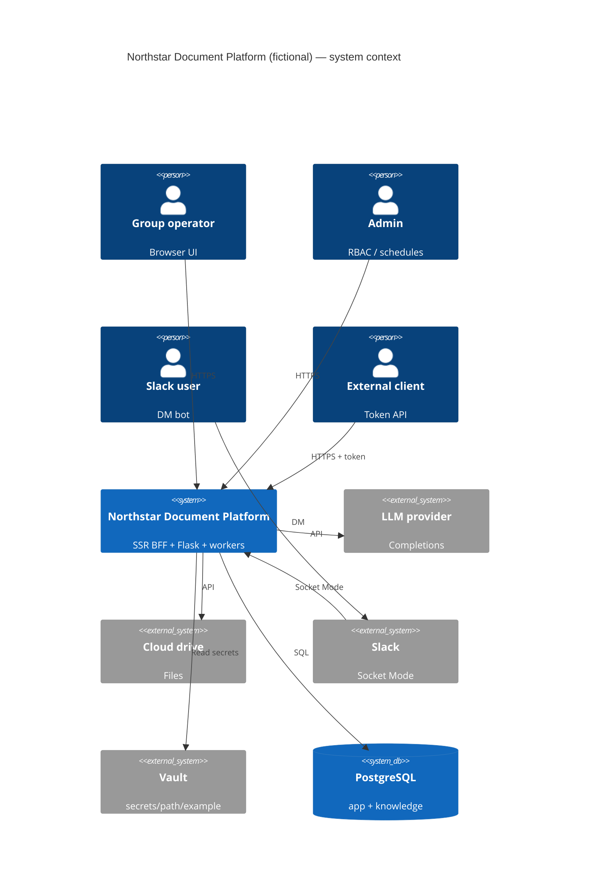

# Contexto de sistema

> Idioma: pt-BR | [English](../../../en/docs/architecture/system-context.md)
>
> Status: ACCEPTED · Owner: example-team
>
> Documentation Standard v1.0
>
> Exemplo **SUGERIDO / ILUSTRATIVO** — produto fictício **Northstar Document Platform**.

## Propósito

Descrever atores, sistemas externos e fronteiras de confiança do sistema ilustrativo Northstar.

## Atores

| Ator | Necessidade | Classification |
| --- | --- | --- |
| Operador de grupo (UI PT-BR) | Upload/análise, chat com fontes | Confirmed (within example) |
| Admin de grupo / global | RBAC, agendas, catálogo de modelos, knowledge ops | Confirmed (within example) |
| Usuário Slack | DM no bot → mesmo pipeline de chat | Confirmed (within example) |
| Integrador externo | `/external/*` com tokens escopados | Confirmed (within example) |
| Engenheiro / agente de IA | Docs nesta árvore de exemplo | Confirmed (within example) |

## Sistemas externos

| Sistema | Interação | Classification |
| --- | --- | --- |
| Provedor LLM externo | Analysis + chat completions | Proposed (example only) |
| Cloud drive | Sync/fetch de pastas | Proposed (example only) |
| Slack API (Socket Mode) | Eventos + respostas | Proposed (example only) |
| Vault / secret store | Segredos em `secrets/path/example` | Proposed (example only) |
| IdP de identidade | SSO opcional | Unknown |

## Diagrama de contexto

## Fronteiras de confiança

| Fronteira | Dentro | Fora | Classification |
| --- | --- | --- | --- |
| Browser ↔ BFF | Cookie de sessão / auth header | Browser não confiável | Confirmed (within example) |
| BFF ↔ API | Rede privada ou DNS do cluster | Internet pública opcional | Inferred |
| API ↔ LLM / Drive | Credenciais só no servidor | Redes do vendor | Confirmed (within example) |
| Worker ↔ Slack | App token / socket | Slack cloud | Proposed (example only) |

## Relacionados

- [overview.md](overview.md)
- [../security/overview.md](../security/overview.md)
