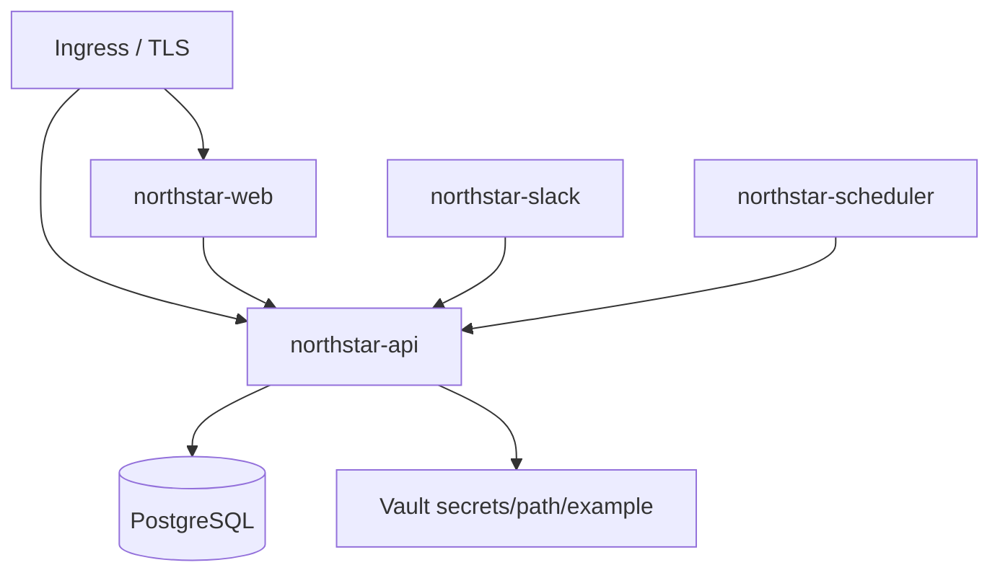

# Infraestrutura / deploy (ilustrativo)

> Idioma: pt-BR | [English](../../../en/docs/infrastructure/deployment.md)
>
> Status: ACCEPTED · Owner: example-team
>
> Documentation Standard v1.0
>
> **SUGERIDO / ILUSTRATIVO** — container + values estilo Helm são **específicos da org**, não mandato Olivelas nem do framework.

## Propósito

Esboçar como artefatos da Northstar podem ser publicados: imagens de container, workloads Kubernetes opcionais e injeção de segredos via env ou placeholders de path Vault.

## Artefatos

| Artifact | Contents | Classification |
| --- | --- | --- |
| Web image | Node SSR BFF + static assets | Proposed (example only) |
| API image | Flask app + worker entrypoints | Proposed (example only) |
| Values file | Replicas, URLs, feature flags, `secrets/path/example` | Proposed (example only) |

## Ambientes (placeholders)

| Env | Frontend | API |
| --- | --- | --- |
| local | `http://localhost:8080` | `http://localhost:5000` |
| staging | `https://docs.staging.example.com` | `https://api.docs.staging.example.com` |
| prod | `https://docs.example.com` | `https://api.docs.example.com` |

## Topologia

## Relacionados

- [../operations/deploy-k8s.md](../operations/deploy-k8s.md)
- [../operations/local-dev.md](../operations/local-dev.md)
- [../security/overview.md](../security/overview.md)
