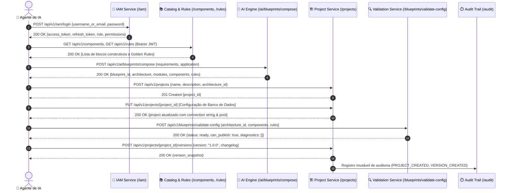

# 🤖 Guia de Integração e Roadmap de API para Agentes de IA

> **Padrão Técnico Olivelas Documentation**  
> **Status:** Confirmed / Ativo  
> **Público-alvo:** Agentes Autônomos de IA (Cursor, Claude Code, Antigravity) & Engenheiros de Software  
> **Versão da API:** v1.0.0  
> **Última Atualização:** Outubro / 2026  

---

## 🏛️ 1. Contexto e Visão Geral da Arquitetura

O **Olivelas App Builder Engine** expõe uma API RESTful completa, projetada especificamente para ser consumida tanto por interfaces visuais quanto por **Agentes Autônomos de Inteligência Artificial**. 

Através desta API, um Agente de IA pode:
1. **Autenticar-se** de forma segura via JWT Bearer Token com controle granular de acesso (RBAC).
2. **Consultar o Catálogo Corporativo** contendo mais de 180 componentes, 20 templates e 25 Golden Rules canônicas.
3. **Compor Blueprints** determinísticos e orientados por IA para novas aplicações.
4. **Criar e Registrar Projetos** na plataforma.
5. **Configurar Conexões com Bancos de Dados** (PostgreSQL, MySQL, SQLite) incluindo parâmetros de pooling, migrações (Alembic) e schemas.
6. **Validar Conformidade Arquitetural** antes da geração ou publicação de código.
7. **Registrar Snapshots de Versão SemVer** no histórico imutável de auditoria (*Universal Audit Trail*).



---

### 1.1 Rotas e Serviços de Desenvolvimento Local

| Serviço | Modo | Endereço de Acesso | Log de Execução |
| :--- | :--- | :--- | :--- |
| **Backend (FastAPI)** | Desenvolvimento | `http://127.0.0.1:8000` | `task-746.log` |
| **Frontend (React + Vite)** | Desenvolvimento | `http://localhost:5173` | `task-750.log` |
| **Documentação da API** | Swagger UI | `http://127.0.0.1:8000/docs` | — |
| **Documentação Técnica** | ReDoc | `http://127.0.0.1:8000/redoc` | — |
| **Health Check** | JSON Liveness | `http://127.0.0.1:8000/health` | — |

---

## 🔐 2. Gestão de Autenticação e Ciclo de Vida do Token JWT

Todas as requisições autenticadas da API devem enviar o cabeçalho HTTP:
```http
Authorization: Bearer <SEU_ACCESS_TOKEN_JWT>
```

### 2.1 Obtenção do Token de Acesso (`/api/v1/iam/login`)
- **Método**: `POST`
- **Endpoint**: `/api/v1/iam/login` (ou `/api/v1/iam/auth/login`)
- **Headers**: `Content-Type: application/json`

**Request Payload:**
```json
{
  "username_or_email": "willian.jesus@olivelas.com.br",
  "password": "admin_dev_pass"
}
```

> [!TIP]
> Em produção ou pipelines de CI/CD, injete essas credenciais através de variáveis de ambiente: `LOFT_ADMIN_USER` e `LOFT_ADMIN_PASSWORD`.

**Response (200 OK):**
```json
{
  "data": {
    "access_token": "eyJhbGciOiJIUzI1NiIsInR5cCI6IkpXVCJ9...",
    "refresh_token": "eyJhbGciOiJIUzI1NiIsInR5cCI6IkpXVCJ9...",
    "token_type": "bearer",
    "expires_in": 7200,
    "user": {
      "id": "usr_admin01",
      "name": "Willian Jesus",
      "email": "willian.jesus@olivelas.com.br",
      "username": "willian.jesus",
      "role": "Global Admin",
      "permissions": ["projects:create", "projects:update", "ai.gateway:execute", "..."]
    }
  },
  "meta": {}
}
```

### 2.2 Renovação de Token Expirado (`/api/v1/iam/auth/refresh`)
Quando o `access_token` expirar (padrão de 2 horas / 7200s), utilize o `refresh_token` sem necessidade de reinserir a senha:
- **Método**: `POST`
- **Endpoint**: `/api/v1/iam/auth/refresh`
- **Request Payload:**
```json
{
  "refresh_token": "eyJhbGciOiJIUzI1NiIsInR5cCI6IkpXVCJ9..."
}
```

### 2.3 Inspeção de Claims e Sessão Ativa (`/api/v1/iam/auth/me`)
- **Método**: `GET`
- **Endpoint**: `/api/v1/iam/auth/me`
- **Headers**: `Authorization: Bearer <TOKEN>`

---

## 🗺️ 3. Roadmap em 7 Etapas para Agentes de IA

| Etapa | Ação da IA | Endpoint Principal | Payload Chave |
| :--- | :--- | :--- | :--- |
| **Etapa 1** | Checagem de Liveness & Readiness | `GET /health` | N/A |
| **Etapa 2** | Autenticação & Extração do Token | `POST /api/v1/iam/login` | `username_or_email`, `password` |
| **Etapa 3** | Descoberta de Catálogo & Regras | `GET /api/v1/components`<br>`GET /api/v1/rules` | Filtros opcionais de categoria |
| **Etapa 4** | Composição de Blueprint por IA | `POST /api/v1/ai/blueprints/compose` | `application`, `requirements` |
| **Etapa 5** | Criação de Projeto no Banco | `POST /api/v1/projects` | `name`, `description`, `architecture_id` |
| **Etapa 5b**| Configuração de Banco de Dados | `PUT /api/v1/projects/{id}` | `requirements` (PostgreSQL/MySQL params) |
| **Etapa 6** | Validação Arquitetural & Golden Rules | `POST /api/v1/blueprints/validate-config` | `architecture_id`, `component_ids`, `rule_ids` |
| **Etapa 7** | Snapshot SemVer & Publicação | `POST /api/v1/projects/{id}/versions` | `version`: "1.0.0", `changelog` |

---

## 💾 4. Como Configurar e Utilizar Banco de Dados no Projeto

Para que o projeto gerado utilize banco de dados de forma padronizada, o Agente de IA deve definir a especificação na entidade do projeto ou blueprint.

### 4.1 Padrão de Configuração Relacional (PostgreSQL / MySQL)
Ao atualizar o projeto via `PUT /api/v1/projects/{project_id}`:
```json
{
  "requirements": [
    "Database Type: postgresql",
    "Connection Host: db.loft.internal",
    "Connection Port: 5432",
    "Database Name: loft_realestate_db",
    "Connection Pooling: 25 connections",
    "SSL Mode: require",
    "Migrations Engine: alembic"
  ],
  "tags": [
    "ai-agent",
    "db:postgresql",
    "pool:configured",
    "env:production"
  ]
}
```

### 4.2 Boas Práticas Canônicas da Olivelas para Banco de Dados
- **Connection Pooling**: Sempre utilizar pooling de conexões (ex.: SQLAlchemy `QueuePool` com `pool_size=20`, `max_overflow=10`).
- **Segurança**: Nunca hardcodar senhas de banco; utilizar referências a variáveis de ambiente (`DATABASE_URL`, `POSTGRES_PASSWORD`).
- **Migrações**: Utilizar Alembic para versionamento determinístico do schema relacional.

---

## 💻 5. Exemplos Completos de Código

### 5.1 Exemplo em Node.js (TypeScript / JavaScript ESM)

Arquivo: [`scripts/ai_agent_workflow.mjs`](file:///Users/willian.jesus/Downloads/aiops-quick-start-app/scripts/ai_agent_workflow.mjs)

```javascript
import fetch from 'node-fetch'; // ou fetch nativo no Node.js 18+

const BASE_URL = process.env.APP_BUILDER_BASE_URL || 'http://127.0.0.1:8000';
const API_V1 = `${BASE_URL}/api/v1`;

async function runAIAgentPipeline() {
  // 1. Autenticação e Obtenção do Token JWT
  const loginRes = await fetch(`${API_V1}/iam/login`, {
    method: 'POST',
    headers: { 'Content-Type': 'application/json' },
    body: JSON.stringify({
      username_or_email: process.env.LOFT_ADMIN_USER || 'willian.jesus@olivelas.com.br',
      password: process.env.LOFT_ADMIN_PASSWORD || 'admin_dev_pass'
    })
  });
  const loginData = await loginRes.json();
  const token = loginData.data.access_token;
  const authHeaders = {
    'Content-Type': 'application/json',
    'Authorization': `Bearer ${token}`
  };

  // 2. Composição de Blueprint via AI Engine
  const blueprintRes = await fetch(`${API_V1}/ai/blueprints/compose`, {
    method: 'POST',
    headers: authHeaders,
    body: JSON.stringify({
      application: { name: 'Portal Imobiliário Node AI', description: 'Sistema com PostgreSQL' },
      requirements: ['Autenticação JWT', 'Banco de Dados PostgreSQL', 'Tabela de Contratos'],
      generate_ai_rationale: true
    })
  });
  const blueprint = await blueprintRes.json();

  // 3. Criação do Projeto
  const projectRes = await fetch(`${API_V1}/projects`, {
    method: 'POST',
    headers: authHeaders,
    body: JSON.stringify({
      name: 'Portal Imobiliário Node AI',
      description: 'Criado via Agente de IA Node.js',
      architecture: 'Modular Monolith',
      tags: ['ai-agent', 'database:postgresql']
    })
  });
  const project = (await projectRes.json()).data;

  // 4. Configuração do Banco de Dados PostgreSQL no Projeto
  await fetch(`${API_V1}/projects/${project.id}`, {
    method: 'PUT',
    headers: authHeaders,
    body: JSON.stringify({
      requirements: [
        'Database Type: postgresql',
        'Connection Host: db.loft.internal',
        'Connection Port: 5432',
        'Database Name: loft_realestate_db',
        'Connection Pooling: 25 connections'
      ]
    })
  });

  // 5. Criação de Snapshot de Versão (SemVer v1.0.0)
  const snapRes = await fetch(`${API_V1}/projects/${project.id}/versions`, {
    method: 'POST',
    headers: authHeaders,
    body: JSON.stringify({
      version: '1.0.0',
      changelog: 'Release inicial com banco de dados PostgreSQL configurado'
    })
  });
  const snap = (await snapRes.json()).data;
  console.log(`✅ Projeto criado e versionado com sucesso: ${project.id} (v${snap.version})`);
}

runAIAgentPipeline().catch(console.error);
```

---

### 5.2 Exemplo em Python

Arquivo: [`scripts/ai_agent_workflow.py`](file:///Users/willian.jesus/Downloads/aiops-quick-start-app/scripts/ai_agent_workflow.py)

```python
import os
import requests

BASE_URL = os.getenv("APP_BUILDER_BASE_URL", "http://127.0.0.1:8000")
API_V1 = f"{BASE_URL}/api/v1"

# 1. Autenticação e Obtenção do Token JWT
login_payload = {
    "username_or_email": os.getenv("LOFT_ADMIN_USER", "willian.jesus@olivelas.com.br"),
    "password": os.getenv("LOFT_ADMIN_PASSWORD") or os.getenv("DEFAULT_ADMIN_PASSWORD", "admin_dev_pass"),
}
login_res = requests.post(f"{API_V1}/iam/login", json=login_payload).json()
access_token = login_res["data"]["access_token"]
headers = {
    "Content-Type": "application/json",
    "Authorization": f"Bearer {access_token}",
}

# 2. Composição de Blueprint via AI Engine
compose_payload = {
    "application": {
        "name": "Portal Imobiliário Python AI",
        "description": "Sistema com PostgreSQL gerenciado por IA",
    },
    "requirements": [
        "Autenticação JWT",
        "Banco de Dados PostgreSQL relacional",
        "Tabela de Propostas com paginação",
    ],
    "generate_ai_rationale": True,
}
blueprint = requests.post(f"{API_V1}/ai/blueprints/compose", json=compose_payload, headers=headers).json()

# 3. Criação de Projeto
proj_payload = {
    "name": "Portal Imobiliário Python AI",
    "description": "Projeto criado via Python AI Agent",
    "architecture": "Modular Monolith",
    "tags": ["ai-agent", "database:postgresql"],
}
project = requests.post(f"{API_V1}/projects", json=proj_payload, headers=headers).json()["data"]
project_id = project["id"]

# 4. Configuração de Banco de Dados
db_config_payload = {
    "requirements": [
        "Database Type: postgresql",
        "Connection Host: db.loft.internal",
        "Connection Port: 5432",
        "Database Name: loft_realestate_db",
        "Connection Pooling: 25 connections",
    ]
}
requests.put(f"{API_V1}/projects/{project_id}", json=db_config_payload, headers=headers)

# 5. Snapshot de Versão SemVer
version_payload = {
    "version": "1.0.0",
    "changelog": "Release inicial com banco de dados PostgreSQL",
}
snap = requests.post(f"{API_V1}/projects/{project_id}/versions", json=version_payload, headers=headers).json()["data"]

print(f"✅ Projeto {project_id} criado e versionado em v{snap['version']}!")
```

---

### 5.3 Exemplo em cURL & Bash

Arquivo: [`scripts/ai_agent_workflow.sh`](file:///Users/willian.jesus/Downloads/aiops-quick-start-app/scripts/ai_agent_workflow.sh)

```bash
#!/usr/bin/env bash
set -e

BASE_URL="http://127.0.0.1:8000"
API_V1="${BASE_URL}/api/v1"

# 1. Login e obtenção do Bearer Token
LOGIN_RESP=$(curl -s -X POST "${API_V1}/iam/login" \
  -H "Content-Type: application/json" \
  -d '{"username_or_email": "willian.jesus@olivelas.com.br", "password": "admin_dev_pass"}')

ACCESS_TOKEN=$(echo "${LOGIN_RESP}" | jq -r '.data.access_token')
AUTH_HEADER="Authorization: Bearer ${ACCESS_TOKEN}"

# 2. Composição de Blueprint por IA
COMPOSE_RESP=$(curl -s -X POST "${API_V1}/ai/blueprints/compose" \
  -H "Content-Type: application/json" \
  -H "${AUTH_HEADER}" \
  -d '{
    "application": {"name": "Portal Imobiliário cURL", "description": "Sistema com PostgreSQL"},
    "requirements": ["Autenticação JWT", "Banco PostgreSQL", "Tabela de Propostas"]
  }')

# 3. Criação de Projeto
PROJECT_RESP=$(curl -s -X POST "${API_V1}/projects" \
  -H "Content-Type: application/json" \
  -H "${AUTH_HEADER}" \
  -d '{
    "name": "Portal Imobiliário cURL",
    "description": "Criado via cURL pipeline",
    "architecture": "Modular Monolith",
    "tags": ["ai-agent", "database:postgresql"]
  }')

PROJECT_ID=$(echo "${PROJECT_RESP}" | jq -r '.data.id')

# 4. Configuração do Banco de Dados
curl -s -X PUT "${API_V1}/projects/${PROJECT_ID}" \
  -H "Content-Type: application/json" \
  -H "${AUTH_HEADER}" \
  -d '{
    "requirements": [
      "Database Type: postgresql",
      "Connection Host: db.loft.internal",
      "Connection Port: 5432",
      "Database Name: loft_realestate_db",
      "Connection Pooling: 25 connections"
    ]
  }'

# 5. Snapshot de Versão
curl -s -X POST "${API_V1}/projects/${PROJECT_ID}/versions" \
  -H "Content-Type: application/json" \
  -H "${AUTH_HEADER}" \
  -d '{
    "version": "1.0.0",
    "changelog": "Release inicial via pipeline cURL"
  }'

echo "✅ Pipeline cURL concluído com sucesso para o projeto ${PROJECT_ID}!"
```

---

## 🛠️ 6. Resolução de Falhas e Códigos de Status Canônicos (`rul_loft_be_error_codes`)

Todas as respostas seguem o envelope `ApiResponse` (`rul_loft_be_api_envelope`): `{ "data": ..., "meta": ..., "error": { "code": "...", "message": "...", "details": {}, "request_id": "..." } }`.

| Código HTTP | `error.code` Canônico | Causa Provável | Ação Corretiva do Agente de IA |
| :--- | :--- | :--- | :--- |
| `401 Unauthorized` | `AUTHENTICATION_FAILED` | Token ausente, vazio, malformado, expirado ou credenciais inválidas. | Chamar `POST /api/v1/iam/auth/refresh` ou renovar login com `POST /api/v1/iam/auth/login`. |
| `403 Forbidden` | `PERMISSION_DENIED` | Usuário/Role não possui a permissão necessária na matriz RBAC. | Inspecionar `GET /api/v1/iam/auth/me` e `GET /api/v1/iam/contract` para verificar a role ativa. |
| `404 Not Found` | `NOT_FOUND` | Recurso (`project_id`, `blueprint_id`, `component_id`) inexistente. | Validar listagem prévia via `GET /api/v1/projects` ou criar o recurso antes de consultá-lo. |
| `409 Conflict` | `CONFLICT` | E-mail/usuário já cadastrado ou conflito de estado. | Utilizar o recurso existente ou atualizar via `PUT`. |
| `422 Unprocessable` | `VALIDATION_ERROR` | Schema inválido no payload ou política de senha não atendida. | Validar campos obrigatórios conforme `/openapi.json` e `GET /api/v1/iam/contract`. |
| `423 Locked` | `ACCOUNT_LOCKED` | Conta bloqueada após 5 tentativas falhas consecutivas de login (bloqueio de 15 min). | Desbloquear via admin (`POST /api/v1/iam/users/{id}/unlock`) ou aguardar expiração do lockout. |
| `429 Too Many Requests` | `RATE_LIMITED` | Limite de requisições por minuto excedido (10 req/min em auth, 120 req/min geral). | Aplicar exponential backoff antes de repetir a chamada. |
| `500 Server Error` | `INTERNAL_ERROR` | Erro interno inesperado no backend. | Consultar logs da plataforma com `request_id` ou verificar `/health`. |

---

## 🔐 7. Contrato IAM para Aplicações e Endpoints Complementares

- **Contrato IAM Canônico (`GET /api/v1/iam/contract`)**: Retorna `role_permissions_matrix`, `security_configuration` (TTL de Access Token 24h / 86400s, Refresh Token 7d / 604800s, JWT `HS256`, política de senha PBKDF2-HMAC-SHA256 / bcrypt, lockout em 5 falhas por 15 min com `423 ACCOUNT_LOCKED`, rate limit com `429 RATE_LIMITED`, e recomendação de armazenamento seguro no browser), além dos schemas de auto-cadastro e grupos.
- **Auto-cadastro Público (`POST /api/v1/iam/auth/signup`)**: Cria usuário com papel padrão `Viewer` e grupo `grp_viewers`, retornando `201 Created` com tokens JWT prontos para uso.
- **Membros de Grupos (`GET / POST / DELETE /api/v1/iam/groups/{group_id}/members`)**: Lista, adiciona (`201 Created`) e remove membros de grupos IAM.
- **Histórico de Versões de Projetos (`GET /api/v1/projects/{project_id}/versions` e `POST /api/v1/projects/{project_id}/versions`)**: Lista e cria (`201 Created`) snapshots SemVer vinculados ao `blueprint_id`, gravando automaticamente `VERSION_CREATED` em `GET /api/v1/audit/logs?action=VERSION_CREATED&entity_id={project_id}`.

---

## 🛡️ 8. Segurança e Diretrizes de Engenharia da Olivelas

1. **Proteção de Segredos**: Nunca comite senhas ou connection strings em repositórios Git públicos. Utilize sempre variáveis de ambiente (`.env`) ou secrets managers.
2. **Auditoria Contínua**: Toda operação realizada por um Agente de IA gera um registro na trilha de auditoria (`/api/v1/audit/logs`) associando o email do autor autenticado via JWT e a ação executada.
3. **Imutabilidade de Snapshots**: Snapshots de versão SemVer são gravados como registros imutáveis no banco SQLite para garantir rastreabilidade completa.

